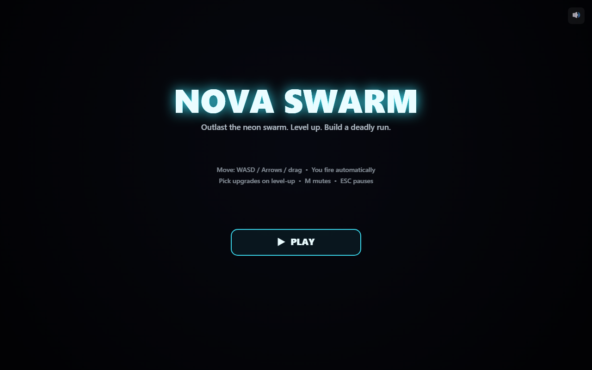
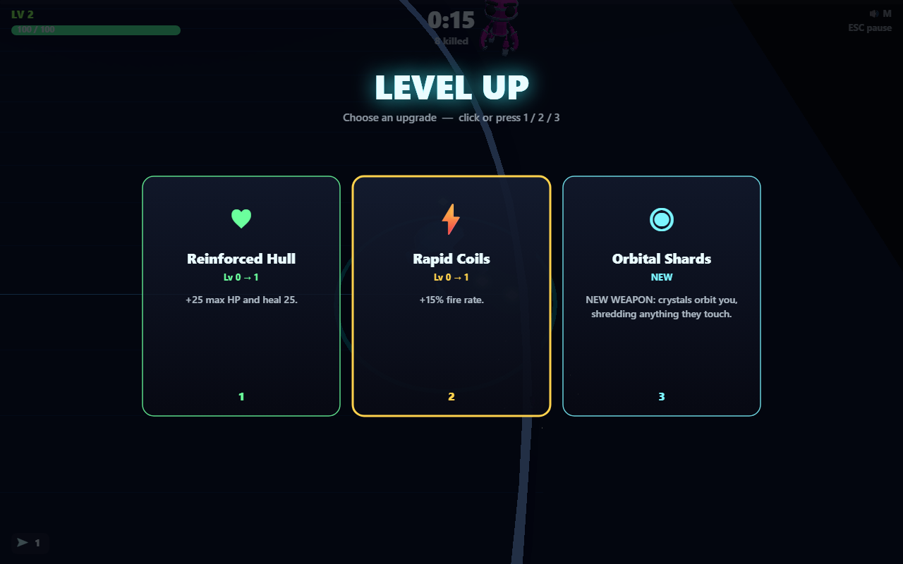
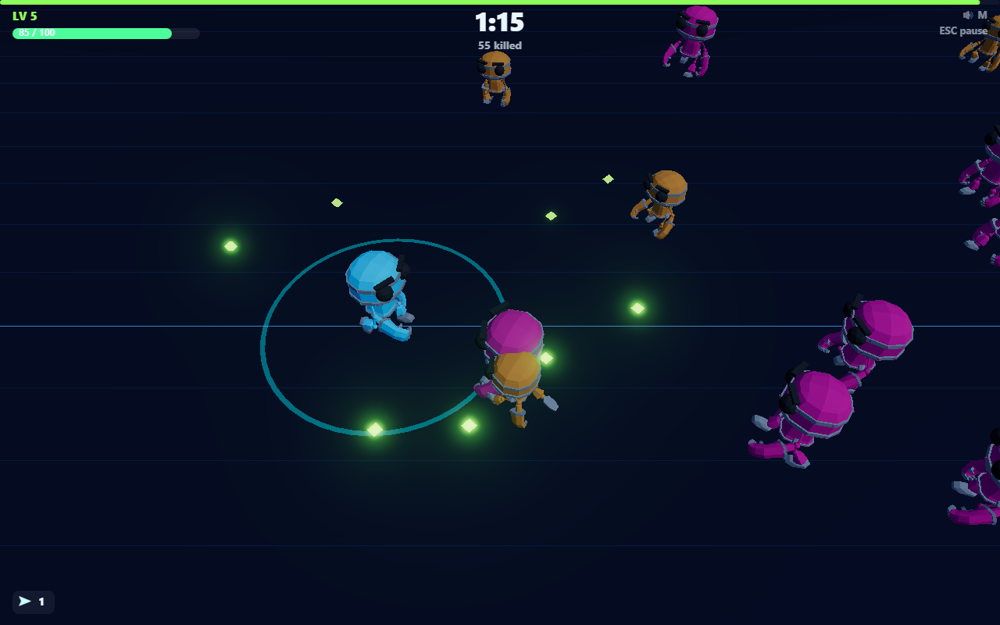
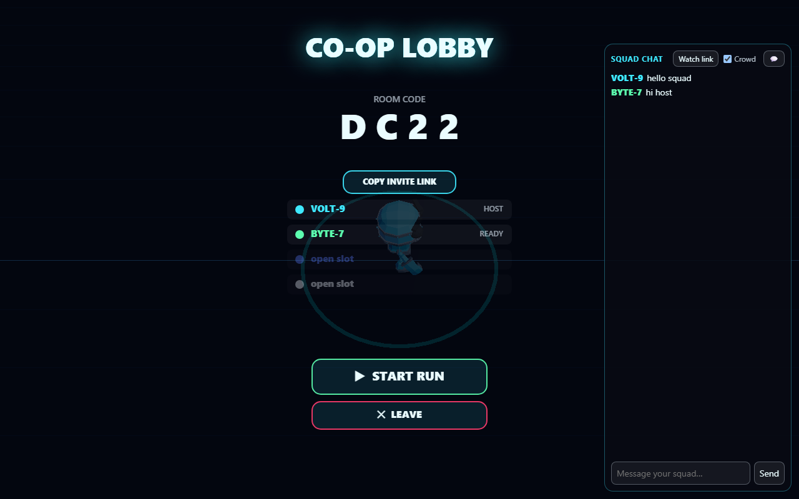
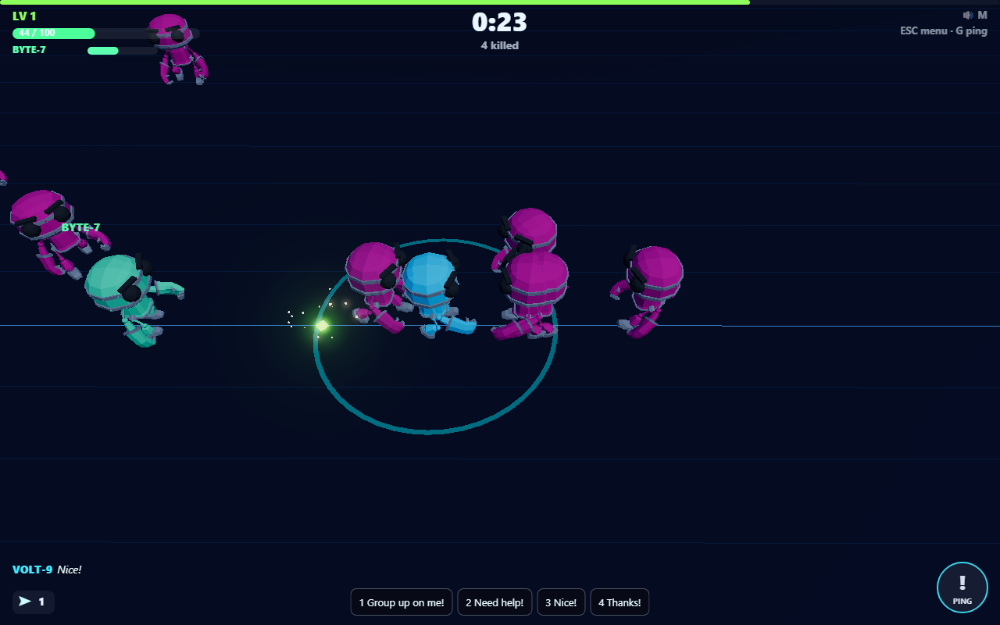
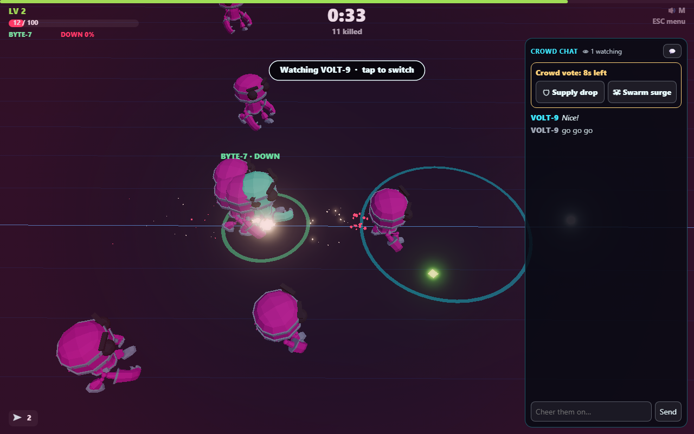
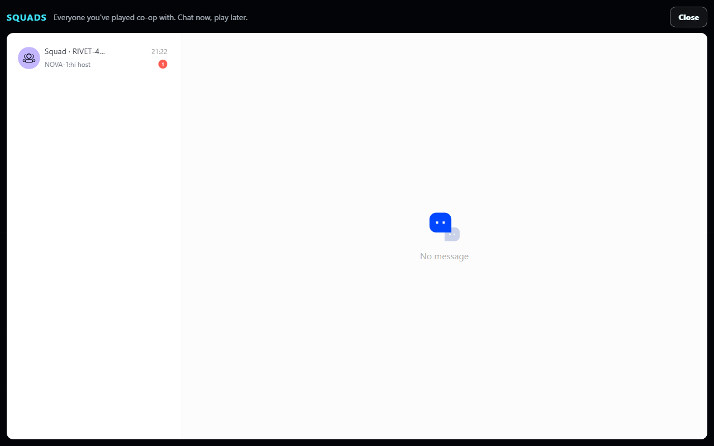

# NOVA SWARM

**A real-time 3D roguelite wave-survivor for 1–4 players, in the browser.** Outlast an endless swarm of rogue robots, sweep up glowing XP crystals, and pick an upgrade every level to build your robot into a screen-clearing storm. Play alone or with friends, talk to your squad, and let a live crowd of spectators vote to change your run.

- 🎮 **Play it:** [novaswarm.vercel.app](https://novaswarm.vercel.app)
- 📦 **Source:** [github.com/rohanjain1648/parsewave](https://github.com/rohanjain1648/parsewave)
- 💬 **Communication powered by [Nexconn](https://nexconn.ai) Chat:** squad chat, quick chat, spectator crowd chat, crowd voting and a Squads inbox

| Title | Level-up | Gameplay |
|---|---|---|
|  |  |  |

| Squad chat in the lobby | Quick chat mid-fight | Spectator crowd vote | Squads inbox (Chat UI) |
|---|---|---|---|
|  |  |  |  |

---

## What's new: talk, watch and vote (Nexconn Chat)

Co-op had one big gap: **players couldn't talk**. Friends who joined by link had no way to call for a revive or plan the next run, and anyone not playing could only watch over someone's shoulder. In a fast action game you also can't stop to type. So every co-op match now has three layers of communication, all built on the Nexconn Chat SDK:

| Feature | What players get | Nexconn building block |
|---|---|---|
| **Squad chat** | Text chat with your squad in the lobby, during the level-up wait, while downed and after the run | One **Group Channel** per room |
| **Quick chat** | One-tap lines that fit the moment ("Revive me!", "Coming, BOLT-7!", "Focus the Warden!"), shown as speech bubbles over the sender's robot | **Custom message types** (not stored) |
| **Spectator mode** | Anyone with the **Watch link** sees the live match without taking a player slot, and switches between players | One **Open Channel** per match |
| **Crowd chat** | Spectators chat as a crowd; players can see their cheers (or hide them) | The match's Open Channel |
| **Crowd voting** | Every 35 s the crowd votes for a **Supply drop** or a **Swarm surge**, and the result hits the live run | Custom messages on the Open Channel |
| **Squads inbox** | A **💬 Squads** button on the title screen lists every squad you've played with, so you can keep chatting between matches | Nexconn **Chat UI** (`@nexconn/chatui`) over persistent Group Channels |

No accounts or sign-ups: the relay server issues each browser a Nexconn token, and the **App Secret never reaches the browser**.

---

## What it is

NOVA SWARM drops a single animated robot into a neon arena full of other robots that want it dead. You **only steer**. Your weapons fire automatically, so every decision is about **positioning** and **build**:

- Kite the swarm, funnel enemies into your fire, and vacuum up the XP crystals they drop.
- Every level-up **freezes time** and offers **3 of 15 upgrades**. Stack them into a run.
- Five enemy archetypes (each a differently tinted, sized and animated robot) ramp in over time; a giant **Warden** boss crashes in every 2 minutes.
- Survive as long as you can. Your best time is saved locally. Then go again.

Rendered in real-time 3D: a rigged, skeletal-animated robot cast (walking, running and idle poses), dynamic lighting with a moving sun and colored rim lights, a selective bloom pass that makes bullets, gems and impacts glow, and a top-down follow camera with impact-driven screen shake.

### How to play

| | |
|---|---|
| **Move** | `WASD` / Arrow keys / drag (touch or mouse) |
| **Fire** | Automatic: aims at the nearest enemy |
| **Level up** | Click a card or press `1` / `2` / `3` |
| **Pause** | `Esc` or `P`, then **Resume** or **Q** to quit to the title screen |
| **Mute** | `M` (or the speaker on the title screen) |
| **Ping** (co-op) | `G` or the **PING** button |
| **Chat** (co-op) | `Enter` to type, or click the chat box |
| **Quick chat** (co-op, mid-run) | `1`–`4`, or tap a line in the bar at the bottom |
| **Switch player** (spectating) | Click / tap or `Tab` |

Everything is playable one-handed on desktop and with a single thumb on mobile (drag anywhere to steer). Any aspect ratio; the view scales to your screen.

### Co-op (2–4 players)

Play one run together with friends. No accounts, just a room code.

- **Host:** tap **HOST CO-OP** on the title screen. You get a 4-letter room code and a **Copy invite link** button. Start the run once at least one friend has joined.
- **Join:** tap **JOIN** and type the code, or just open the invite link (`…/?room=ABCD`).
- **Team XP, personal builds:** everyone's gem pickups fill one XP bar. On each level-up the run pauses and every player picks their own upgrade (15 s, then one is picked for you).
- **Downed, not dead:** at 0 HP you go down. A teammate who stands next to you for 3 seconds revives you at 30% HP. The run ends only when the whole squad is down.
- **Ping:** press `G` (or tap **PING**) to drop a marker your squad can see, with an edge arrow when it's off-screen.
- The swarm scales with squad size. Co-op best times are tracked separately from solo.
- **Crossplay:** the Android app and the website share rooms. App players bring their chosen robot's stats; website players use the standard robot.

### Upgrades & weapons

- **Blaster** (start): auto-targeting shots; upgrades add fire rate, damage, projectiles and pierce.
- **Orbital Shards:** crystals orbit you, shredding anything they touch.
- **Pulse Nova:** a periodic shockwave that damages and knocks back the swarm.
- Plus stat upgrades: max HP, regen, armor, move speed, crit, magnet radius and XP gain.

---

## Chat, spectators and the crowd in detail

### Squad chat

- Opens next to the game as soon as you host or join. Messages show the sender's callsign in their robot's color.
- Full chat in the **lobby**, during the **level-up wait**, while you're **downed** and on the **game-over** screen. During active play the panel shrinks to the quick-chat bar, so it never covers the fight. The 💬 button hides or shows it at any time.
- Typing in chat never moves your robot: the game ignores keys while the chat box has focus.
- Click a player's name to **mute** them for this session.

### Quick chat

Both hands are busy mid-fight, so the bar at the bottom offers **4 lines picked for the moment**:

| Situation | Lines offered first |
|---|---|
| You are downed | "Revive me!" |
| A teammate is downed | "Coming, *name*!" |
| The Warden boss is alive | "Focus the Warden!" |
| Always available | "Group up on me!", "Need help!", "Nice!", "Thanks!" |

Press `1`–`4` or tap a line. It appears as a speech bubble over your robot for your squad and for spectators. Quick lines are sent as an id, not free text, and only known ids are shown, so they can't carry arbitrary text.

### Spectator mode and crowd chat

- In the lobby or mid-run, **Watch link** copies a link like `…/?watch=ABCD`. Opening it shows the live match **without taking a player slot**, and spectators can join mid-run.
- The view follows one player ("Watching VOLT-9 · tap to switch"); click, tap or press `Tab` to follow the next one.
- Spectators get a **Crowd chat** panel ("Cheer them on…"). Players see crowd messages in their chat, marked as crowd, and can hide them with the **Crowd** checkbox. Players also see a live "👁 N watching" count.

### Crowd voting

- The first vote opens **15 s** into a run, then one every **35 s**. Each vote is open for **10 s**.
- Votes only run while at least one spectator is watching, and pause during the level-up wait.
- Spectators pick **🛡 Supply drop** or **☠ Swarm surge**, one vote each.
  - **Supply drop:** a healing crystal lands next to every living player.
  - **Swarm surge:** an extra ring of enemies (6 + 2 per living player, within the normal enemy cap) closes in on the squad.
- The host counts the votes and applies the result inside the game simulation, so every player sees exactly the same outcome. The squad sees a banner like "The crowd chose SWARM SURGE! (3–1)". A tie goes to the supply drop. If nobody votes, nothing happens.
- If the run ends during a vote, the vote card closes cleanly for everyone.

### Squads inbox (Nexconn Chat UI)

- The **💬 Squads** button on the title screen opens Nexconn's ready-made Chat UI, full screen.
- It lists every squad this browser has played with, newest first, named after its players and the date (for example "Squad · VOLT-9, BYTE-7 · Nov 22"), with unread counts and the last message.
- Squad channels stay open after a match, so you can read the history, keep talking and plan the next run. `Esc` or **Close** returns to the title screen.

### Safety and limits

- Messages are capped at 140 characters and names at 12. Text is always rendered as text, never as HTML.
- Players can mute anyone; players can hide the crowd entirely.
- The App Secret lives only on the relay server. Browsers get a per-user token and the public App Key.
- If chat is not configured or Nexconn is unreachable, the chat panel simply doesn't appear. Co-op itself keeps working.

---

## How the Nexconn integration works

```
 Browser (game)                         Relay server (Node, Render)              Nexconn
 ──────────────                         ───────────────────────────              ───────
 1. POST /chat/session  ─────────────▶  register user + issue token  ─────────▶  Server API
                        ◀── token + App Key
 2. NCEngine.connect(token)  ─────────────────────────────────────────────────▶  Chat SDK
 3. host / join room over the game WebSocket
                        ◀── { squadId, watchId }   relay creates the room's
                                                   Group Channel + Open Channel ─▶ Server API
 4. chatJoin(userId) ──────────────▶   adds the player to the Group Channel ───▶  Server API
 5. send / receive squad messages, quick lines, crowd chat and votes ──────────▶  Chat SDK
 6. room closes                        relay dismisses the Open Channel
                                       (the Group Channel stays for the inbox) ─▶ Server API
```

- **Client:** `src/chat/nexconnTransport.ts` is the only file that talks to the SDK. It keeps **one Nexconn connection per page**, shared by in-game chat and the Squads inbox. `src/chat/chatController.ts` holds the chat logic (feed, mute, crowd filter, votes) behind a small transport interface, so it's unit-tested without the network.
- **Identity without accounts:** each browser tab claims an identity slot with the Web Locks API, so a returning player stays the same chat user, while two tabs on one machine count as two people (otherwise Nexconn would sign the first one out). Tokens are cached and refreshed automatically if they go stale.
- **Relay:** `server/src/chatBackend.ts` calls the Nexconn server API (user registration, tokens, creating and dismissing channels, adding members). It signs requests with the App Secret from environment variables. `server/src/rooms.ts` ties each co-op room to its two channels. Spectators only ever get the crowd channel, never the squad channel.
- **Custom message types:** `nova:quick`, `nova:vote_open`, `nova:vote` and `nova:vote_result` are registered as non-persisted messages, so they don't fill up history or unread counts.
- **Crowd vote:** `src/chat/crowdVote.ts` runs the vote timer and tally on the host. The result becomes an input to the deterministic host simulation, which then reaches every client in the normal world snapshots.

---

## Project history: what existed before, what's new

**Before (the original game):**

- A 24-hour game-jam build: the engine, the 3D rendering pipeline, all gameplay, procedural audio and the HUD. The one external asset is the CC0 robot model (see Credits).
- **2–4 player online co-op** added afterwards: room codes, a host-run simulation with binary snapshots, client prediction and interpolation, downed/revive, pings, a Node WebSocket relay on Render, and crossplay with the Android app.

**New for the Nexconn hackathon:**

- All Nexconn integration: the token service on the relay, the channel lifecycle, squad chat, quick chat, crowd chat, crowd voting and the Squads inbox (Chat UI).
- **Spectator mode** itself (watching a live match without a player slot, switching between players).
- Tests for all of it: relay chat unit tests, chat logic unit tests, and a live three-browser test against real Nexconn.

See [`docs/DESIGN.md`](docs/DESIGN.md) for the game's architecture and design decisions, and [`docs/AI_WORKFLOW.md`](docs/AI_WORKFLOW.md) for how it was built.

---

## Run it locally

Requires **Node 18+** (built on Node 22).

```bash
npm install
npm run dev        # http://localhost:5173 with hot reload
```

Production build & preview:

```bash
npm run build      # type-checks (tsc --noEmit) then bundles with Vite → dist/
npm run preview    # serve the production build on http://localhost:4173
```

### Co-op locally

Co-op needs the small relay server in `server/` running next to the game:

```bash
npm --prefix server install
npm --prefix server run dev                         # relay on ws://localhost:8787
VITE_RELAY_URL=ws://localhost:8787 npm run dev      # game, in a second terminal
```

Open two browser windows: host in one, join with the code in the other. Without `VITE_RELAY_URL` the game still runs; the co-op buttons just show "Co-op unavailable".

### Chat locally

Chat needs a Nexconn app. Copy `server/.env.example` to `server/.env` (git-ignored) and fill it in from **Nexconn Console → Key Management**:

```bash
NEXCONN_APP_KEY=...
NEXCONN_APP_SECRET=...
NEXCONN_API_BASE=https://api.sg-light-api.com   # must match your app's region
```

Restart the relay. To test chat, use two **separate browser profiles** (or two browsers) for the host and the joiner, and a third for the Watch link. Without these variables the relay reports chat as off, and the game runs co-op without the chat panel.

### Tests

```bash
npm --prefix server install       # one-time: the relay's own dependencies
npm test                          # unit tests: simulation, snapshots, sessions, relay rooms, chat logic, crowd vote
npm run typecheck                 # strict TypeScript for the game
npm --prefix server run typecheck # and for the relay
```

Browser smoke tests (build first, and install Chromium once with `npx playwright install chromium`):

```bash
npm run smoke        # solo: boots the build, plays ~20 s, checks for errors and that leveling works
npm run smoke:coop   # two browsers: host + joiner through a local relay
npm run smoke:chat   # three browsers against REAL Nexconn: squad chat, quick chat, spectator,
                     # crowd chat, crowd vote, Squads inbox (needs server/.env; sends real messages)
```

Add `?debug` to the game URL to expose a read-only state probe (`window.__nova()`) that the smoke tests use.

---

## Deploy

The game is a fully static bundle (`base: "./"`, so it works at any path) including the ~450 KB robot model.

**Vercel:** import the repo (framework preset: _Vite_) or run:
```bash
npm i -g vercel && vercel --prod
```
`vercel.json` is included.

**GitHub Pages:** push to `main`; the workflow at [`.github/workflows/deploy.yml`](.github/workflows/deploy.yml) builds and publishes to Pages. (Enable Pages → Source: _GitHub Actions_ in repo settings once.)

**Co-op and chat relay (Render):** co-op needs one always-on WebSocket server, which a static host can't provide. The relay in `server/` keeps rooms, forwards game messages and issues chat tokens (no game logic). `render.yaml` deploys it:

1. On [Render](https://render.com): **New → Blueprint**, pick this repo. It creates the `novaswarm-relay` web service (free plan).
2. In the service's **Environment**, add `NEXCONN_APP_KEY`, `NEXCONN_APP_SECRET` and `NEXCONN_API_BASE` to turn chat on.
3. Set the relay URL on the static site, with `wss://` in front, for example `VITE_RELAY_URL=wss://novaswarm-relay.onrender.com` (Vercel → Project → Settings → Environment Variables), then redeploy so the build picks it up. Optionally set `VITE_PUBLIC_URL` to the site's public address so invite and Watch links use it.

On Render's free plan the relay sleeps after ~15 minutes without traffic and takes about a minute to wake. The title screen sends a wake-up request as it loads and shows "Waking co-op server…" until it answers. A paid instance never sleeps (no code change).

---

## Tech stack

- **TypeScript** (strict) + **Vite**. No game framework; the engine is hand-rolled.
- **Three.js** for real-time 3D: `GLTFLoader` + `SkeletonUtils` for animated character instancing, `InstancedMesh` for cheap-at-scale VFX, `EffectComposer` + `UnrealBloomPass` for the glow.
- **HTML5 Canvas 2D** for the HUD and menus, layered over the WebGL canvas; plain DOM for the chat panel.
- **Web Audio API** for fully procedural sound.
- **Nexconn**: `@nexconn/chat` and `@nexconn/engine` (Chat SDK) and `@nexconn/chatui` (Chat UI, built on `lit`), loaded only when chat starts.
- **Node + `ws`** for the relay, deployed on Render.
- **Vitest** and **Playwright** for unit and browser tests.

## Project layout

```
src/
  core/     engine: math+RNG, loop, input, audio (renderer-agnostic)
  game/     config, types, world (pure simulation), player, enemies, upgrades, particles,
            crowd effects (supply drop, swarm surge)
  render/   Three.js layer: scene/lights/bloom, camera, robot loading+animation, instanced FX, world→scene sync
  ui/       HUD overlay, title/level-up/pause/game-over screens, co-op lobby, chat panel, Squads inbox
  net/      co-op: relay protocol + client, binary world snapshots, host/client sessions
  chat/     chat controller, Nexconn transport, quick chat, crowd vote, squad name book
  main.ts   canvas setup, asset preload, state machine, game loop, chat wiring
server/     relay (Node + ws): rooms, reconnect grace, message forwarding, Nexconn token + channel service
test/       Playwright smoke tests (solo, co-op, live chat) and vitest unit tests (test/unit/)
public/models/  the RobotExpressive.glb asset
docs/       design notes, AI workflow, screenshots, submission write-up
```

## Technical Architecture (deep dive)

This section is for readers who want to understand *how* the game systems work, not just what they're built with. (See also [`docs/DESIGN.md`](docs/DESIGN.md) for the design rationale, and the Nexconn section above for the chat architecture.)

### System overview

```
┌─────────────────────────────────────────────────────────────────────┐
│ main.ts — state machine (loading → menu → playing ⇄ levelup/paused  │
│            → gameover) + GameLoop driver + dual-canvas compositing  │
└───────────────┬───────────────────────────────────┬─────────────────┘
                │ update(dt) fixed @60Hz             │ render() every rAF
                ▼                                     ▼
┌───────────────────────────────┐      ┌──────────────────────────────┐
│ game/World — PURE SIMULATION  │      │ render/WorldView — 3D SYNC   │
│  player, enemies[], bullets[],│─────▶│  reads World's pooled arrays │
│  gems[], particles, director, │ data │  writes Three.js transforms, │
│  upgrades, XP/level, RNG      │ only │  tints, animation clips      │
│  (renderer-agnostic)          │      │  (no gameplay logic here)    │
└───────────────┬───────────────┘      └──────────────┬───────────────┘
                │ SpatialGrid queries                  │ scene graph
                ▼                                       ▼
      core/grid.ts (broad-phase)          render/scene.ts (lights, bloom,
                                           ground, composer) + camera3d.ts
                                           (follow + shake) + fx.ts
                                           (instanced VFX) + robots.ts
                                           (GLTF load + per-instance clone)
```

The arrow between `World` and `WorldView` only ever flows one way: `World` never imports anything from `render/`, `core/`, or Three.js. It only exposes plain numbers, pooled struct arrays, and two narrow hooks — `setViewRadius(r)` (so the spawn director knows how far off-screen to place new enemies, without knowing what "screen" means) and `consumeTrauma()` (an accumulator that impact events bump and the camera drains into a shake offset). That one-way boundary is what let the whole rendering layer be swapped from Canvas 2D to Three.js mid-build without touching a single line of physics, spawn-timing, or balance code.

### Simulation core: fixed-timestep accumulator

`core/loop.ts` implements the classic "fix your timestep" pattern: `update(dt)` always receives a constant `dt = 1/60`, called 0, 1, or more times per animation frame depending on how much wall-clock time actually elapsed (an accumulator carries the remainder across frames). This is what makes movement speed, spawn cadence, damage-over-time, and every other rate-based system **identical** regardless of the player's monitor refresh rate — a 240Hz display doesn't make enemies spawn faster or the blaster fire quicker. `render()` runs once per `requestAnimationFrame` regardless of how many sim steps just ran, driven by the *actual* frame delta (`rdt`, clamped to 50ms) so animation-mixer blending and camera easing stay smooth even though the sim ticks in fixed chunks. A 0.25s clamp on the accumulator prevents the "spiral of death" (a stalled tab trying to catch up on thousands of missed steps at once) — reinforced by an explicit auto-pause on the `visibilitychange` event.

### Entity model: pooled structs, index-stable slots

Every transient thing in the game — enemies, player bullets, enemy bullets, XP/heal gems, hit-spark particles, floating combat text — is a plain object (`interface`, not a `class`) held in a flat array with a `dead: boolean` flag. "Spawning" means linear-scanning for a `dead` slot and overwriting its fields in place; nothing is ever `splice`d out mid-array. Two consequences fall out of this:

1. **Zero GC churn in the hot path.** After a brief warm-up, a long run allocates nothing per frame — no `new` calls for gameplay objects, so no garbage-collector stutter 40 minutes into a run.
2. **Index-stable slots are a free entity ID.** Because slot `enemies[7]` is never physically reordered, `render/worldView.ts` can keep a **parallel array of Three.js robot instances at the same index** and just ask each frame "is `enemies[i].dead`? hide `robots[i]` : sync its transform" — no ID-lookup map, no allocation, no diffing.

### Broad-phase collision: uniform spatial hash

Testing every bullet against every enemy is `O(bullets × enemies)`, which falls over once the swarm gets dense. `core/grid.ts` buckets enemies into a uniform grid (cell size 128 game-units) that's cleared and fully rebuilt every simulation step — rebuilding from scratch each step sounds wasteful but is actually the cheapest correct option here (no incremental-update bookkeeping, and a full rebuild of ~140 enemies into a `Map<number, Enemy[]>` is microseconds). Every damage query (blaster bullets, orbital contact-damage sampling, the nova's AoE pulse, the player's own contact-damage check, and the "nearest enemy" auto-aim query) then only inspects the handful of enemies in nearby cells instead of the whole population.

### 3D rendering pipeline

**Asset loading & instancing** (`render/robots.ts`): the single `RobotExpressive.glb` is loaded once via `GLTFLoader`. Every entity that needs a robot body — the player, each of the ~140 possible enemy slots — gets its own instance via `SkeletonUtils.clone()`, **not** `Object3D.clone()`. This distinction matters: a plain clone shares the same `Skeleton` (bone hierarchy) object across every copy, so animating one would visibly animate *all* of them in lockstep; `SkeletonUtils.clone` deep-clones the skeleton per instance while still sharing the underlying geometry buffers (cheap on GPU memory). Each instance also gets its own **cloned copy of just the "Main" material** (the robot's body-color material — the model ships three total: Grey, Main, Black), so `setTint()` can recolor one robot without recoloring every robot sharing that GPU program. An `AnimationMixer` + a small `play(clipName, fadeSeconds)` wrapper handle crossfading between the model's built-in clips (Idle / Walking / Running / Death, selected per enemy tier in `game/config.ts` alongside a per-tier `animSpeed` multiplier — tanks get a slow heavy "Walking" stomp, "fast" enemies get a sped-up "Running").

**Instanced VFX** (`render/fx.ts`): bullets, gems, and hit-particles are **not** individual `Mesh` objects — hundreds of those would mean hundreds of draw calls and matrix updates via the scene graph. Instead each effect type is a single `THREE.InstancedMesh` sized generously up front (e.g. 400 slots for player bullets), and syncing means writing each live entity's transform into `setMatrixAt(i, matrix)` and hiding the rest — one draw call per effect type, total, regardless of whether 3 or 300 are on screen. Color is **not** done via per-instance `instanceColor` (that path reliably rendered solid black in this environment — see the bug-hunt writeup in `DESIGN.md` — likely a SwiftShader/Three.js interaction specific to headless testing, worked around rather than chased further); instead each pool has one fixed material color, and gems/particles that need two colors (XP-green vs. heal-pink; generic white sparks vs. red hurt-sparks) simply get **two pools**, with live entities re-indexed into a compact `0..n` range each frame via a `hideFrom(n)` call that blanks the remainder.

**Lighting & atmosphere** (`render/scene.ts`): one shadow-casting `DirectionalLight` follows the player at a fixed offset (keeping its shadow-camera frustum tight and the shadow map sharp without covering the whole 3200×3200 arena), an ambient + hemisphere light provide fill, and two `PointLight`s slowly orbit the player at a fixed radius purely for neon-colored rim lighting (cheap: position updates only, no extra shadow maps). The ground plane is deliberately **emissive-tinted** rather than relying purely on scene lighting — the very first version reached correctly-lit robots standing on a completely black floor, traced to the ground plane's PBR-lit-only material reading as near-black under the available light budget; giving it its own emissive glow made it lighting-independent and robust.

**Post-processing**: `EffectComposer` → `RenderPass` → `UnrealBloomPass` → `OutputPass`. The bloom threshold is tuned so it only blooms genuinely bright/emissive things (bullets, gems, the arena boundary ring) while the tone-mapped, physically-lit robot materials stay under threshold and don't wash out.

### Camera: fixed-angle follow + trauma-squared shake

`render/camera3d.ts` deliberately does **not** orbit or rotate with the player — it holds a constant pitch/height/back-offset and damps its (x, z) position toward the player's ground-plane position (`damp()` is an exponential smoothing function: `lerp(a, b, 1 - e^(-λt))`, framerate-independent unlike a naive `a += (b-a) * 0.1`). This keeps the arena legible during a chaotic swarm — you always know which way is "up" on screen. Screen shake reuses the "trauma squared" model (trauma accumulates from impacts 0..1, decays over time, and the actual camera offset is `trauma²` in a random direction) so small hits barely register but a boss-kill or a death genuinely rattles the frame, without needing per-effect shake-amount tuning.

### Two-canvas compositing

The page stacks `#scene` (WebGL, Three.js) beneath `#hud` (2D canvas context, cleared to fully transparent every frame except where it actively draws). All crisp text, bars, and menu cards are 2D-canvas draw calls — far simpler than 3D text geometry or a DOM UI library — and `ui/labels3d.ts` bridges the two worlds for in-scene floating combat text: it takes a 3D world position, runs it through `Vector3.project(camera)` to get normalized device coordinates, converts those to HUD-canvas pixel coordinates, and draws the text there, so damage numbers correctly track their 3D origin point as the camera moves.

### Procedural audio

`core/audio.ts` has no audio files at all. Every SFX is a short `OscillatorNode` (or filtered noise buffer for impacts) with a hand-shaped gain envelope and a frequency sweep — e.g. the kill sound is a sawtooth sweeping 160Hz→40Hz layered with filtered noise. The background music is a self-scheduling loop (a `setTimeout` chain reading the AudioContext's own clock, not `setInterval`, to avoid drift) playing a bassline plus a randomized arpeggio over a minor-pentatonic scale, whose note density and detuning increase with a 0–1 "intensity" value the game feeds it from elapsed time + enemy count — so the music organically ramps as a run gets harder.

### State machine & upgrade system

`main.ts` runs an explicit `"loading" | "menu" | "playing" | "levelup" | "paused" | "gameover"` state machine (not a scene-graph of "screen" objects) — each state has one `handleX()` function polling `Input` and one branch in `render()`. Upgrades are implemented as a flat **stats bag** on `Player` (`damageMul`, `fireRateMul`, `projectileCount`, `pierceBonus`, per-weapon levels, …) that upgrade definitions simply mutate; weapons read derived getters off that bag, so the upgrade system has zero coupling to weapon internals — adding a 16th upgrade never requires touching `Blaster`/`Orbital`/`Nova` code.

### Performance budget & why the numbers are what they are

The 2D prototype ran up to 520 concurrent enemies (cheap flat-colored polygons). Real-time skeletal animation is not free, so the 3D build caps concurrent enemies at **140** and particles at **340** — sized to keep every `AnimationMixer.update()` and instanced-mesh sync well inside a 16ms frame budget on mid-range hardware, including the software-rendered (SwiftShader) path used for headless CI testing. Fewer, denser, individually-readable robots reads as "a swarm" just as well as hundreds of flat polygons did, especially with bloom and lighting doing atmospheric work the 2D version didn't have.

## Credits & disclosures

- **Design, code, gameplay, scene/lighting/effects, audio, co-op and chat integration:** all original, by the author with Claude Code as an AI pair-engineer.
- **3D model:** [`RobotExpressive.glb`](https://github.com/mrdoob/three.js/tree/dev/examples/models/gltf/RobotExpressive) by [Tomás Laulhé](https://www.patreon.com/quaternius), **CC0 1.0** (public domain), with glTF conversion/cleanup by [Don McCurdy](https://donmccurdy.com/), distributed via the three.js examples repository. Used as-is (tinted per-instance in code; not re-modeled). This is the one non-original asset in the submission.
- **Libraries:** `three` (3D rendering), `@nexconn/chat`, `@nexconn/engine` and `@nexconn/chatui` (chat, by Nexconn) with `lit`, `ws` (relay), `vite` and `typescript` (build tooling), `vitest` and `playwright` (dev-only, for tests).
- **Fonts:** system UI fonts only (no third-party font files).
- **Audio:** none — fully procedural, generated in code at runtime.
- **Prior work / tutorials / templates:** none used beyond the disclosed model. The genre is inspired by _Vampire Survivors_; no code or other assets were taken from it or any other project.

## License

[MIT](LICENSE) © 2026 the author. The bundled `RobotExpressive.glb` remains CC0 1.0 per its original license (see Credits above).
